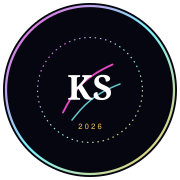

<div align="center">

# Strandlight

**손으로 허공에 빛의 줄을 그리고, 연주하세요.**

웹캠 손 추적으로 움직이는 브라우저 악기입니다. 설치할 것도 없고, 카메라 영상은 기기 밖으로 나가지 않습니다.

[**▶ 라이브 데모 열기**](https://mipuxen.github.io/strandlight/)

[English](README.md) · [O'zbekcha](README.uz.md) · 한국어 · [Русский](README.ru.md)

</div>

## 소개

대부분의 "에어 하프"는 줄이 미리 정해져 있습니다. Strandlight에서는 **악기를 직접 만듭니다**. 엄지와 검지를 집고, 당기고, 놓으면 빛나는 줄이 그 자리에 남습니다. **줄의 길이가 소리를 정합니다**: 짧은 줄은 유리처럼, 중간 줄은 하프처럼, 긴 줄은 베이스처럼 울립니다.

| 제스처               | 결과                                      |
| -------------------- | ----------------------------------------- |
| 집기 → 당기기 → 놓기 | 새 줄이 허공에 고정됨                     |
| 검지가 줄을 지나감   | 연주됨. 빠를수록 크게                     |
| 빠르게 튕기기        | 가장 가까운 줄을 따라 불꽃이 흐름         |
| 줄 끝을 집기         | 줄을 옮기거나 늘이기 (뮤지션, 비르투오소) |
| 주먹                 | 모든 소리 멈춤                            |
| 손바닥 1초           | 서스테인과 리버브 (뮤지션, 비르투오소)    |
| 두 손 모두           | 손끝 사이 5개의 실이 패드 화음을 연주     |

카메라가 없어도 됩니다. **길게 누른 뒤 끌면** 줄이 그려지고, **빠르게 쓸면** 연주됩니다.

**단축키:** `Z` 실행 취소 · `Shift+Z` 다시 실행 · `C` 지우기 · `V` 카메라 배경 · `Space` 루퍼 · `H` 도움말

## 기능

- **3가지 모드:** 입문 (C 마이너 펜타토닉, 틀린 음 없음), 뮤지션 (히자즈·블루스 포함 12개 스케일, 루퍼, 피치 벤드, 서스테인), 비르투오소 (반음계/자유 조율, 벨로시티, A4 432–446 Hz, 실제 하프 프리셋, MIDI·OSC).
- **샘플 파일 없이 코드로 합성한 소리:** FM(크리스털), AudioWorklet 카플러스-스트롱(하프), 카플러스-스트롱 + 서브 사인(베이스), 리버브·딜레이·리미터.
- **4레이어 루퍼**와 **메트로놈**(40–200 BPM, 탭 템포).
- **장면 저장:** 기기, JSON 파일, 공유 가능한 `#scene=` 링크. 서버 불필요.
- **녹화:** 장면, 카메라, 전체 화면을 MP4(또는 WebM)로 바로 다운로드. 마이크 불필요.
- **Web MIDI**, [`strandlight-bridge`](packages/bridge)를 통한 **OSC** (TouchDesigner, Max, Ableton).
- **3가지 테마**, **12개 언어** (브라우저 언어 자동 감지), **고스트 핸드 인터랙티브 가이드**.

## 개인정보 보호

손 추적(MediaPipe)은 **기기 안의 Web Worker에서** 실행됩니다. 카메라 프레임과 손 좌표는 어디에도 전송되지 않습니다. 쿠키·분석·계정이 없습니다. 런타임·모델·폰트는 모두 사이트에 직접 호스팅되며 빌드 시 해시로 검증됩니다. 자세히: [docs/PRIVACY.md](docs/PRIVACY.md).

## 직접 실행하기

```bash
git clone https://github.com/mipuxen/strandlight.git
cd strandlight
npm install
npm run dev
```

## 어떻게 만들었나

Strandlight는 **Khoshimov Shukhratbek**이 기획하고 주도했으며, **[Claude](https://claude.ai)(Anthropic)를 AI 페어 프로그래머로** 함께 만들었습니다. 함께 작성한 커밋에는 `Co-Authored-By: Claude` 줄이 있어 기록에 그대로 남습니다.

에이전틱 소프트웨어 엔지니어링이었고, 사람이 맡은 부분이 곧 엔지니어링이었습니다:

1. **스펙 먼저.** 코드 이전에 콘셉트, 제스처, 사운드, 모드, 테마, 다국어, 개인정보, 보안, 배포, 단계별 로드맵까지 전체 스펙을 작성하고 모든 열린 질문을 명시적으로 결정했습니다 ([docs/SPEC.md](docs/SPEC.md)).
2. **이유 있는 결정.** 프레임워크 없는 Vite + TypeScript(번들 200 KB 미만), Web Worker 추적, 샘플 대신 합성, 서버 없는 코어.
3. **단계마다 리뷰.** 각 부분을 읽고, 질문하고, 승인한 뒤 다음으로 넘어갔습니다.
4. **요구사항으로서의 보안.** 해시 고정 자산, CSP, lint로 강제한 `textContent` 렌더링, 장면 입력 검증, localhost 전용 OSC 브리지, CodeQL·Dependabot·SHA 고정 Actions.
5. **가정이 아닌 검증.** 단위 테스트, 헤드리스 브라우저 스모크 테스트, CI 게이트.

## 만든 사람

<table>
  <tr>
    <td></td>
    <td>
      <b>Khoshimov Shukhratbek (코시모프 슈크라트벡)</b><br />
      AI Agentic Software Engineer<br />
      콘셉트, 스펙, 제품 방향, 리뷰, 릴리스<br />
      <a href="https://github.com/mipuxen">github.com/mipuxen</a>
    </td>
  </tr>
</table>

## 라이선스

[MIT](LICENSE) © 2026 Khoshimov Shukhratbek
