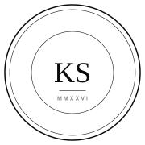

<div align="center">

# Strandlight

**Рисуйте руками струны из света в воздухе. А потом играйте на них.**

Браузерный инструмент на основе отслеживания рук через веб-камеру. Ничего не нужно устанавливать, а изображение с камеры не покидает ваше устройство.

[**▶ Открыть демо**](https://mipuxen.github.io/strandlight/)

[English](README.md) · [O'zbekcha](README.uz.md) · [한국어](README.ko.md) · Русский

</div>

## Что это

В большинстве «воздушных арф» струны уже заданы. В Strandlight **инструмент создаёте вы**: сведите большой и указательный пальцы, потяните и отпустите — светящаяся струна останется там, где вы её оставили. **Длина определяет голос**: короткие струны звенят как стекло, средние — как арфа, длинные — как бас.

| Жест                                 | Результат                                   |
| ------------------------------------ | ------------------------------------------- |
| Свести пальцы → потянуть → отпустить | Новая струна застывает в воздухе            |
| Указательный палец пересекает струну | Струна звучит, быстрее — громче             |
| Резкий щелчок                        | Искры бегут по ближайшей струне             |
| Взять струну за конец                | Сдвинуть или растянуть (Музыкант, Виртуоз)  |
| Знак V (указательный + средний), ½ с | Всё затихает                                |
| Открытая ладонь 1 с                  | Сустейн и реверберация (Музыкант, Виртуоз)  |
| Обе руки в кадре                     | Пять нитей между пальцами играют аккорд-пэд |

Нет камеры? Работают касания и мышь: **нажмите и удерживайте, затем тяните**, чтобы нарисовать; **проведите быстро**, чтобы сыграть.

**Клавиши:** `Z` отменить · `Shift+Z` повторить · `C` очистить · `V` фон с камеры · `Space` лупер · `H` помощь

## Возможности

- **3 режима:** Новичок (до-минорная пентатоника, фальшивых нот нет), Музыкант (12 ладов, включая хиджаз и блюз, лупер, питч-бенд, сустейн), Виртуоз (хроматический или свободный строй, сила удара, A4 = 432–446 Гц, пресет «настоящая арфа», MIDI и OSC).
- **Звук синтезируется в коде**, без сэмплов: FM (Crystal), Карплус-Стронг в AudioWorklet (Harp), Карплус-Стронг + саб-синус (Bass), реверберация, дилей и лимитер.
- **Лупер** на 4 слоя и **метроном** (40–200 BPM, тап-темп).
- **Сцены** сохраняются на устройстве, в JSON-файл или в ссылку `#scene=`. Сервер не нужен.
- **Запись видео** сцены, камеры или всего экрана в MP4 (или WebM) сразу в загрузки. Микрофон не нужен.
- **Web MIDI** и **OSC** через [`strandlight-bridge`](packages/bridge) (TouchDesigner, Max, Ableton).
- **3 темы**, **13 языков** (определяются по настройкам браузера), **интерактивный гид с «призрачной рукой» в натуральную величину** (6 шагов, с подсказками). Потом он сворачивается в маленькую кнопку «Как играть», а **H** открывает справку с анимацией каждого жеста.

## Приватность

Отслеживание рук (MediaPipe) работает **в Web Worker на вашем устройстве**. Кадры с камеры и точки рук никуда не отправляются. Нет cookies, аналитики и аккаунтов. Среда выполнения, модель и шрифты размещены на самом сайте и проверяются по хешу при сборке. Подробнее: [docs/PRIVACY.md](docs/PRIVACY.md).

## Запуск

```bash
git clone https://github.com/mipuxen/strandlight.git
cd strandlight
npm install
npm run dev
```

## Как это создавалось

Strandlight спроектирован и создан под руководством **Khoshimov Shukhratbek** вместе с **[Claude](https://claude.ai) (Anthropic) в роли AI-напарника по программированию**.

Это была агентная разработка, и человеческая часть работы — это инженерия:

1. **Сначала спецификация.** До кода была написана полная спецификация: концепция, жесты, звук, режимы, темы, языки, приватность, безопасность, деплой и этапы. Каждый открытый вопрос решён явно ([docs/SPEC.md](docs/SPEC.md)).
2. **Решения с обоснованием.** Vite + TypeScript без фреймворков (бандл < 200 КБ), трекинг в Web Worker, синтез вместо сэмплов, ядро без сервера.
3. **Ревью на каждом этапе.** Каждая часть прочитана, обсуждена и одобрена.
4. **Безопасность как требование.** Ресурсы с фиксированными хешами, CSP, вывод только через `textContent` (правило линтера), проверка сцен, OSC-мост только на localhost, CodeQL, Dependabot, Actions с фиксацией по SHA.
5. **Проверено, а не предположено.** Юнит-тесты, smoke-тест в headless-браузере, проверки в CI.

## Автор

<table>
  <tr>
    <td><picture><source media="(prefers-color-scheme: dark)" srcset="docs/assets/seal-dark.svg" /></picture></td>
    <td>
      <b>Khoshimov Shukhratbek</b> «Bruce»<br />
      AI Agentic Software Engineer<br />
      Концепция, спецификация, продукт, ревью и релиз<br />
      <a href="https://github.com/mipuxen">github.com/mipuxen</a>
    </td>
  </tr>
</table>

## Лицензия

[MIT](LICENSE) © 2026 Khoshimov Shukhratbek
