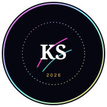

<div align="center">

# Strandlight

**Havoga qo'lingiz bilan yorug'lik torlarini chizing. Keyin ularni chaling.**

Webcam orqali qo'l kuzatuviga asoslangan brauzer cholg'usi. Hech narsa o'rnatish kerak emas, kamera tasviri qurilmangizdan chiqmaydi.

[**▶ Jonli demoni ochish**](https://mipuxen.github.io/strandlight/)

[English](README.md) · O'zbekcha · [한국어](README.ko.md) · [Русский](README.ru.md)

</div>

## Bu nima

Ko'pchilik "havo arfa"larida torlar oldindan qotirilgan bo'ladi. Strandlight'da **cholg'uni o'zingiz yasaysiz**: bosh va ko'rsatkich barmog'ingizni qisib, torting va qo'yib yuboring — yorug' tor siz qoldirgan joyda turib qoladi. **Uzunligi uning ovozini belgilaydi**: qisqa torlar shishadek, o'rtachalari arfadek, uzunlari basdek yangraydi.

| Imo-ishora                         | Natija                                              |
| ---------------------------------- | --------------------------------------------------- |
| Qisish → tortish → qo'yib yuborish | Yangi tor havoda qotadi                             |
| Ko'rsatkich barmoq tordan o'tadi   | Tor chalinadi, tezroq bo'lsa balandroq              |
| Tez chertish                       | Eng yaqin tor bo'ylab uchqunlar ketadi              |
| Tor uchini qisib ushlash           | Torni ko'chirish yoki cho'zish (Musiqachi, Virtuoz) |
| Musht                              | Hammasi jim bo'ladi                                 |
| Ochiq kaft 1 soniya                | Sustain va reverb kuchayadi (Musiqachi, Virtuoz)    |
| Ikkala qo'l ko'rinsa               | Barmoq uchlari orasida 5 ta ip pad akkord chaladi   |

Kamera yo'qmi? Barmoq va sichqoncha ham ishlaydi: **bosib turing, keyin torting** — tor chiziladi; **tez surib o'ting** — chalinadi.

**Tugmalar:** `Z` bekor qilish · `Shift+Z` qaytarish · `C` tozalash · `V` kamera foni · `Space` looper · `H` yordam

## Imkoniyatlar

- **3 rejim:** Boshlovchi (C minor pentatonika, xato nota yo'q), Musiqachi (12 gamma, jumladan Hijoz va Blyuz, looper, pitch bend, sustain), Virtuoz (xromatik yoki erkin sozlash, velocity, A4 = 432–446 Hz, "haqiqiy arfa" preseti, MIDI va OSC).
- **Ovoz kod bilan sintez qilinadi**, sample fayl yo'q: FM (Crystal), AudioWorklet'da Karplus-Strong (Harp), Karplus-Strong + sub sinus (Bass), reverb, delay va limiter.
- **Looper** (4 qatlam, tempga kvantlangan), **metronom** (40–200 BPM, tap tempo).
- **Sahnani saqlash:** qurilmaga, JSON faylga yoki ulashiladigan `#scene=` havolaga. Server kerak emas.
- **Video yozish:** sahna, kamera yoki butun ekran, MP4 (yoki WebM) bo'lib to'g'ridan-to'g'ri yuklab olinadi. Mikrofon kerak emas.
- **Web MIDI** va [`strandlight-bridge`](packages/bridge) orqali **OSC** (TouchDesigner, Max, Ableton uchun).
- **3 mavzu:** Neon Cosmos, Golden Harp, White Silk. **12 til**, brauzer tilidan avtomatik tanlanadi.
- **Arvoh qo'l bilan interaktiv guide** — 5 qadam, har biri siz bajarganda yakunlanadi.

## Maxfiylik

Qo'l kuzatuvi (MediaPipe) **qurilmangizning o'zida, Web Worker ichida** ishlaydi. Kamera kadrlari va qo'l nuqtalari hech qayerga yuborilmaydi. Cookie, analitika va akkaunt yo'q. MediaPipe runtime, model va shriftlar saytning o'zida joylashgan va build paytida hash orqali tekshiriladi. Batafsil: [docs/PRIVACY.md](docs/PRIVACY.md).

## O'zingiz ishga tushiring

```bash
git clone https://github.com/mipuxen/strandlight.git
cd strandlight
npm install
npm run dev
```

## Qanday qurilgan

Strandlight'ni **Khoshimov Shukhratbek** loyihalagan va boshqargan, **[Claude](https://claude.ai) (Anthropic) AI pair-programmer** sifatida yordam bergan.

Bu agentic software engineering edi va inson tomonidagi ish — muhandislik:

1. **Avval spetsifikatsiya.** Koddan oldin to'liq spec yozildi: konsepsiya, imo-ishoralar, ovoz dizayni, rejimlar, mavzular, tillar, maxfiylik, xavfsizlik, deploy va bosqichlar. Har bir ochiq savol aniq hal qilindi ([docs/SPEC.md](docs/SPEC.md)).
2. **Sababli qarorlar.** Frameworksiz Vite + TypeScript (bundle < 200 KB); tracking Web Worker'da (ovoz va render to'xtamaydi); ovoz sintez qilinadi (repo yengil, litsenziya muammosi yo'q); serversiz core (har kim GitHub'dan ishga tushira oladi).
3. **Har bosqichda review.** Har bir qism o'qildi, savol berildi va tasdiqlandi.
4. **Xavfsizlik talab sifatida.** Hash bilan tekshiriladigan assetlar, CSP, faqat `textContent` (lint qoidasi bilan), sahna fayllarini tekshirish, faqat localhost'da ishlaydigan OSC bridge, CodeQL, Dependabot, SHA bo'yicha pin qilingan Actions.
5. **Tekshirilgan, taxmin qilinmagan.** Unit testlar, headless brauzerda smoke test, CI lint/test/tarjima/bundle hajmini tekshiradi.

## Muallif

<table>
  <tr>
    <td></td>
    <td>
      <b>Khoshimov Shukhratbek</b> "Bruce"<br />
      AI Agentic Software Engineer<br />
      Konsepsiya, spec, mahsulot yo'nalishi, review va reliz<br />
      <a href="https://github.com/mipuxen">github.com/mipuxen</a>
    </td>
  </tr>
</table>

## Litsenziya

[MIT](LICENSE) © 2026 Khoshimov Shukhratbek
